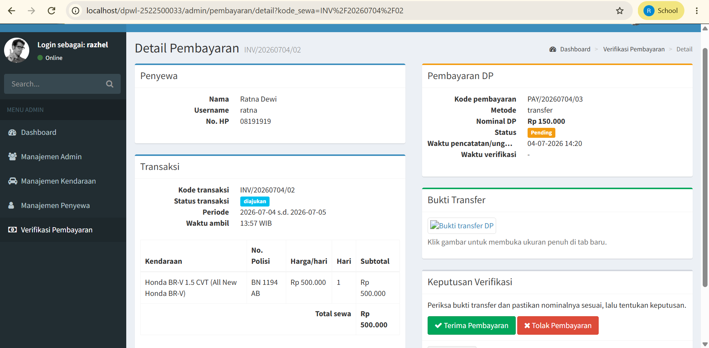
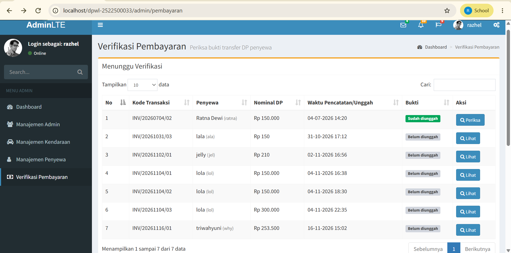
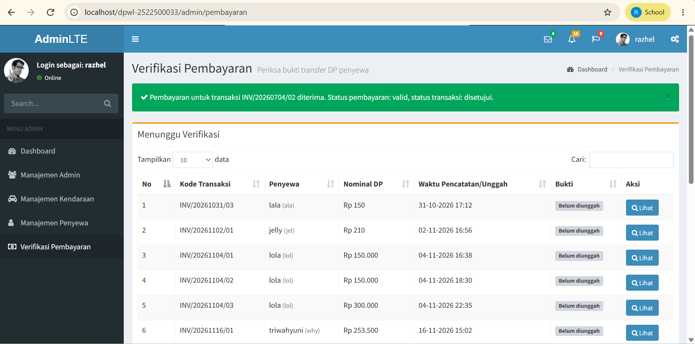
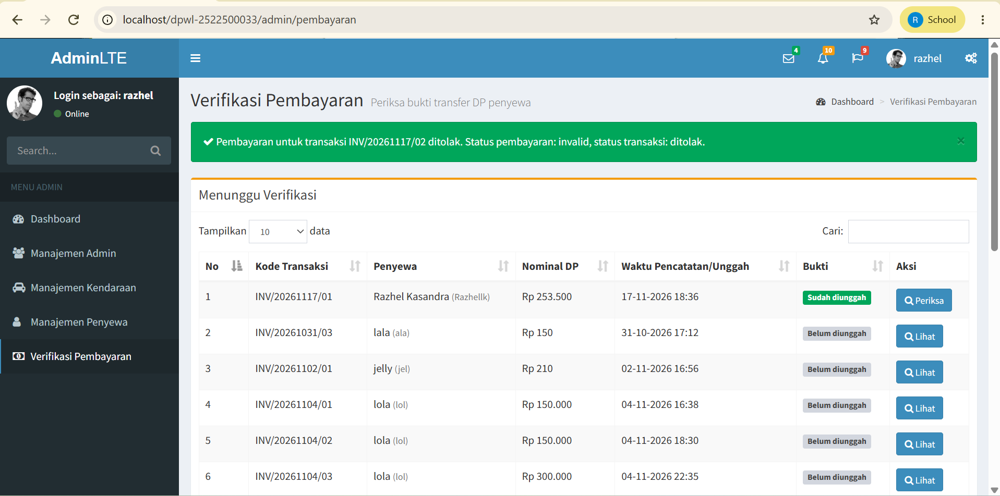
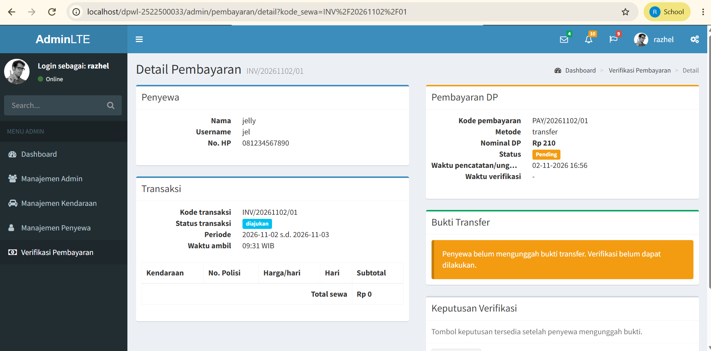

# pertemuan-09

1. saya membuat halaman pembayaran penyewa agar penyewa dapat mengunggah bukti transfer DP 30% dari transaksi yang sudah di-checkout.
saya membuat proses unggah bukti yang memperbarui record DP yang sudah dibuat saat checkout P7, bukan membuat record DP baru.
saya membuat menu verifikasi pembayaran untuk admin berisi daftar, detail, dan tombol terima atau tolak
saya menambahkan token CSRF, pembatasan akses, dan penyimpanan bukti yang tertutup agar bukti pembayaran tidak bisa dibuka sembarang orang.
perubahan dan file yang saya buat.
saya membuat menu daftar pembayaran penyewa dengan membuat application\views\pembayaran\index.php
saya membuat halaman pembayaran dan form unggah bukti dengan membuat application\views\pembayaran\form.php
saya membuat proses pembayaran penyewa dengan membuat application\controllers\Pembayaran_controller.php
saya membuat query pembayaran dan verifikasi dengan membuat application\models\Pembayaran_model.php
saya membuat halaman verifikasi admin dengan membuat application\controllers\Mpembayaran_controller.php dan application\views\admin\mpembayaran_view.php
saya membuat token CSRF dengan membuat application\helpers\csrf_helper.php
menambahkann 6 baris route baru pertemuan-09\application\config\routes.php
saya menutup akses langsung ke bukti pembayaran dengan membuat uploads\bayar\.htaccess

2. Fitur yang Ditambahkan
* Sisi Penyewa: Penyewa dapat melihat daftar serta rincian tagihan DP, lalu mengunggah bukti transfer (dengan validasi berkas ketat) ke direktori uploads/bayar yang memperbarui data gambar (ft_byr) dan waktu bayar (tgl_wkt_byr), sementara status tetap pending.
* Sisi Admin: Admin memiliki menu Pembayaran baru untuk memeriksa rincian transaksi beserta foto bukti transfer yang diunggah penyewa, lalu menentukan keputusan melalui tombol Terima atau Tolak
* Perubahan Status: Keputusan verifikasi dijalankan dalam satu transaksi database dengan mencatat waktu verifikasi (tgl_wkt_ver). Jika diterima, status pembayaran menjadi valid dan sewa disetujui; jika ditolak, status pembayaran menjadi invalid dan sewa ditolak

3. Aturan Bisnis yang Diterapkan
* Otentikasi & Otorisasi Ketat: Semua pengguna wajib login, peran penyewa dan admin dipisahkan secara tegas (akses tidak sah ditolak dengan kode 403), serta penyewa hanya bisa mengakses tagihannya sendiri tanpa membocorkan keberadaan data milik orang lain.
* Keamanan & Integritas Data: Nominal pembayaran mutlak diambil dari database (bukan input form), dan proses pembayaran hanya memperbarui record DP yang sudah ada saat checkout (tidak membuat data baru)
* Kontrol Alur Unggah & Verifikasi: Bukti transfer wajib ada sebelum diverifikasi admin. Selama status masih pending, penyewa boleh mengunggah ulang bukti (file lama dihapus otomatis setelah database terbarukan), namun jika status sudah final (valid/invalid), data terkunci dan tidak bisa diubah lagi

4. Route Baru
 Bagian ini mendefinisikan enam routing baru di application/config/routes.php yang dipisahkan berdasarkan hak akses pengguna, dengan parameter kode_sewa dikirim melalui query string (karena mengandung karakter garis miring /)

 * Akses Penyewa (Pembayaran_controller): Menyediakan route untuk melihat daftar tagihan (/pembayaran), melihat rincian (/pembayaran/detail), dan mengirim bukti transfer (/pembayaran/unggah)
 * Akses Admin (Verifikasi_controller): Menyediakan route khusus admin untuk memantau daftar pembayaran masuk (/admin/pembayaran), memeriksa rincian bukti (/admin/pembayaran/detail), dan memproses keputusan verifikasi (/admin/pembayaran/verifikasi)

 5. Pembagian MVC
 * Model (Pembayaran_model.php): Mengelola query data pembayaran dan relasinya menggunakan prepared statement, serta menjaga integritas proses verifikasi lewat transaksi database dan SELECT ... FOR UPDATE
 * Controller (Pembayaran_controller & Verifikasi_controller): Memisahkan alur logika bisnis penyewa (validasi unggahan, cek kepemilikan, pola PRG) dengan alur admin (autentikasi admin dan eksekusi keputusan verifikasi)
 * View & Integrasi Berkas: Menambahkan 4 halaman tampilan baru (daftar dan detail untuk masing-masing peran), memperbarui berkas navigasi (navbar.php, sidebar.php), rute (routes.php), alur redirect setelah checkout (Transaksi_controller.php), serta menyiapkan direktori penyimpanan uploads/bayar/.

 6. Hasil Pengujian Fungsional
 * Alur Penyewa Menguji tampilan rincian DP setelah checkout, unggah bukti transfer yang valid (status tetap pending), serta penolakan otomatis terhadap unggahan yang kosong, melebihi batas ukuran, atau berformat tidak sah
 * Alur Admin Memastikan daftar pembayaran masuk dan bukti transfer dapat diperiksa, perubahan status pada tabel t_bayar dan t_sewa akurat saat diterima atau ditolak, serta mencegah verifikasi tanpa bukti maupun verifikasi ulang 
 * Keamanan Hak Akses & Log Perbaikan Menguji pemblokiran pengguna yang belum login, pencegahan akses lintas akun penyewa, pembatasan menu admin, serta menyediakan tabel pencatatan temuan dan perbaikan selama pengujian

 7. Tangkapan Layar

1. Hasil Pengujian 1
   
2. Hasil Pengujiann 2
   
3. Hasil Pengujian 3
   
4. Hasil Pengujian 4
   
5. Hasil Pengujian 5
   

---
