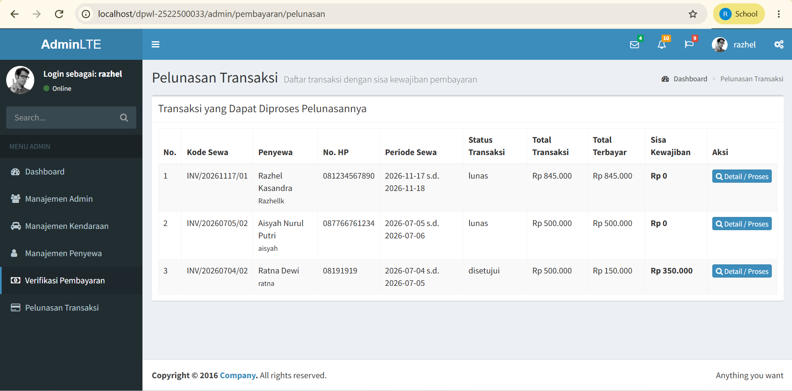
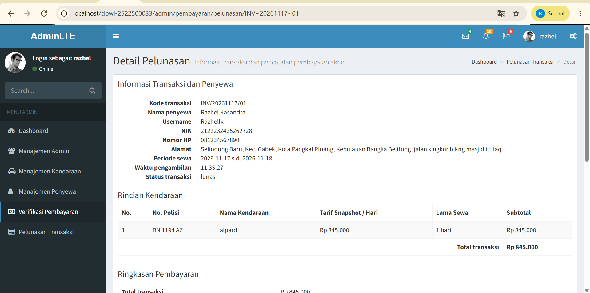
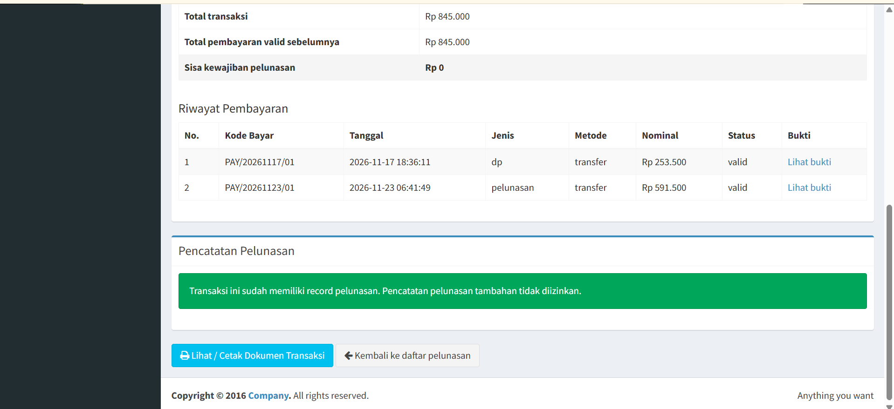
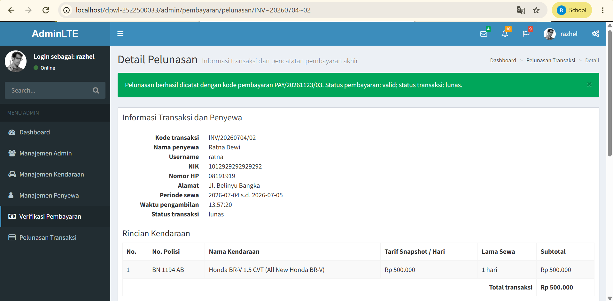
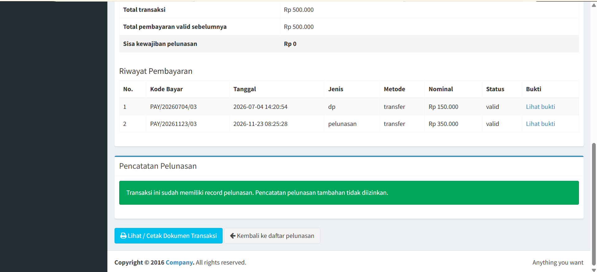
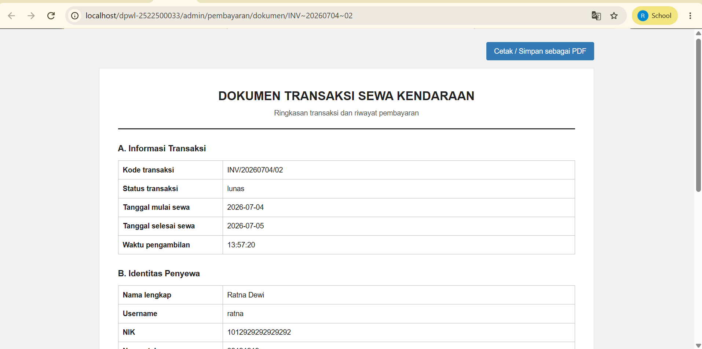

# pertemuan-10
1. Memverifikasi Perubahan Struktur Basis Data perintah penambahan nilai lunas pada ENUM kolom status_sewa
2. Mengimplementasikan Model Pelunasan pada application\models\Pembayaran_model.php
* menambahkan method getDaftarPelunasan() 
* menambahkan method getDetailPelunasan(string $kodeSewa)
* menambahkan method internal buatKodeBayarPelunasan(string $tanggalKode)
* Validasi pelunasan dilakukan di dalam method simpanPelunasan() sebelum data pembayaran disimpan.
Tambahkan method simpanPelunasan(string $kodeSewa, string $metodeBayar, ?string $namaFileBukti =
null)
* melakukan pemeriksaan awal terhadap Model Pelunasan
3. Implementasi Controller Pelunasan
* Menampilkan Daftar Transaksi yang Belum Lunas
Menambhkan method pelunasanIndex() digunakan untuk menampilkan daftar transaksi yang masih memiliki kewajiban
pelunasan
* Menampilkan Detail Pelunasan
menambhkan Method pelunasanDetail(string $kodeSewa) digunakan untuk menampilkan detail transaksi, riwayat
pembayaran, dan sisa kewajiban.
* Memproses Pelunasan
menambkan Method prosesPelunasan(string $kodeSewa) digunakan untuk mencatat pembayaran pelunasan yang diterima
langsung oleh admin
* Menampilkan Dokumen Transaksi
menambhkan Method dokumenTransaksi(string $kodeSewa) digunakan untuk menampilkan dokumen transaksi yang siap
dicetak
4. Menambahkan kode codingan Route Pelunasan
Penambahan route daftar pelunasan.
* Penambahan route detail pelunasan.
* Penambahan route proses pelunasan.
* Penambahan route dokumen transaksi.
* Integrasi menu Pelunasan pada sidebar admin.
* Hasil pemeriksaan route dan navigasi
5. Membuat View Daftar dan Detail Pelunasan
* Membuat application\views\admin\pelunasan.php
menampilkan daftar transaksi yang masih memiliki kewajiban pembayaran
* Membuat   application\views\admin\pelunasan_detail.php
untuk menampilkan detail transaksi yang akan dilunasi. Gunakan data detailPelunasan yang
dikirimkan
6. Membuat Dokumen Transaksi
* menampilkan ringkasan penyewaan dan riwayat pembayaran berdasarkan
data yang tersimpan pada basis data
7. Bukti dokumentasi hasil 
1. Hasil Pengujian 1
   
2. Hasil Pengujiann 2
   
3. Hasil Pengujian 3
   
4. Hasil Pengujian 4
   
5. Hasil Pengujian 5
   
6. Hasil Pengujian 6
   
